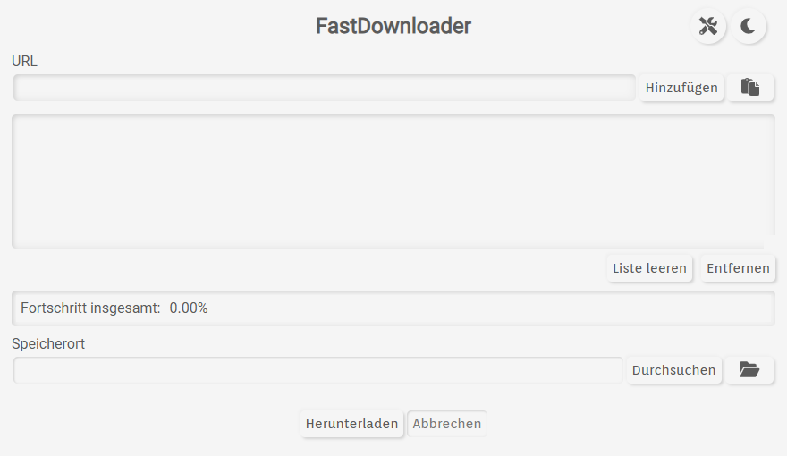
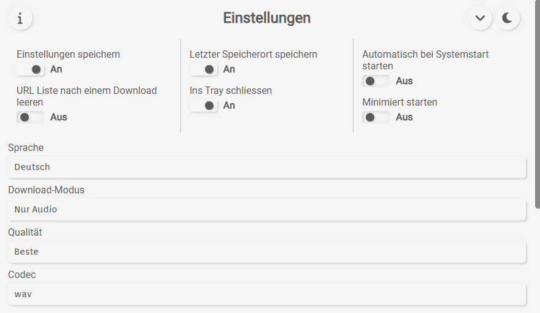
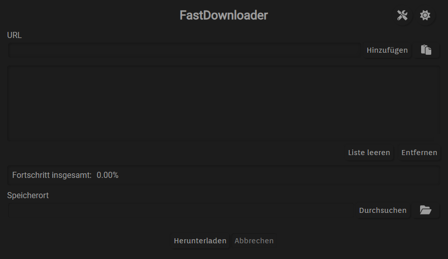

**Download your favourite videos, music, and playlists — without the hassle.**

FastDownloader is a **free, open-source desktop app** that makes it easy to save audio and videos from YouTube and many other websites. Just paste a link, choose where to save your files, and start downloading. No command line required.

**[Download FastDownloader](https://github.com/BERNARDO31P/FastDownloader/releases/latest)** · [See supported websites](https://github.com/yt-dlp/yt-dlp/blob/master/supportedsites.md) · [Report a problem](https://github.com/BERNARDO31P/FastDownloader/issues)

## What can FastDownloader do?

### Download videos or just the audio

Save videos to watch later, or download only the audio when all you want is the music. Choose from popular audio formats such as **MP3, M4A, FLAC, WAV, and Opus**, and select the audio quality you prefer.

### Download entire playlists

Paste a YouTube playlist link and FastDownloader will find its tracks **before the download starts**. Expand the playlist to see what's inside and follow each track's progress. You can mix playlists and individual links in the same download list.

### Download several files at once

Don't wait for one file to finish before starting the next. FastDownloader can handle **up to four downloads at the same time**. Add more links while your downloads are running, and watch their progress in one place.

### Choose different settings for different downloads

Want one video in its original format and another as an MP3? **Right-click a link or playlist track** to choose its download type, quality, format, or save folder. You don't have to use the same settings for everything.

### Stay in control

- **Pause and resume** your download queue when you need to.
- **Abort** a batch if you want to stop active downloads.
- Keep an eye on the progress of individual files and the whole queue.
- Use the **system tray** to control downloads without keeping the main window open.

*When you pause, files that are already downloading are allowed to finish; new ones won't start until you resume.*

### Made for everyday use

- **Light and dark themes** to suit your desktop.
- **16 languages**, including English, German, French, Spanish, Portuguese, Italian, and many more.
- Optional **start with your computer**, **start minimized**, and **close to tray** settings.
- Save your preferences and last download folder, if you choose.
- Built-in checks for application and download-tool updates.

### YouTube Music and Premium support

When downloading audio from YouTube, FastDownloader can try to find the corresponding **YouTube Music** version automatically. If it can't find a suitable match, it keeps the original link.

If you have **YouTube Premium**, you can optionally let FastDownloader use your existing browser session for supported downloads — there's no separate login inside the app. This depends on your browser and operating system. **Chrome cookie access is not supported by the app on Windows**; try another supported browser, such as Firefox, for this feature.

## Get started in three steps

1. **[Download the latest release](https://github.com/BERNARDO31P/FastDownloader/releases/latest)** for your computer and install or open it.
2. Open **Settings** to choose **Audio only** or **Video and audio**, your preferred format, and your download folder.
3. **Paste a video or playlist link**, click **Add**, and then click **Download**.

That's it. You can add several links at once, and you can right-click individual items to customise them before they start.

## Screenshots

**Main window — light theme**

**Settings**

**Main window — dark theme**

## Download and supported systems

FastDownloader provides release packages for **Windows and Linux**. Depending on the release, you may find a Windows installer (`.exe`) or Linux packages such as `.deb`, `.rpm`, and `.AppImage`.

**[Get FastDownloader on GitHub Releases](https://github.com/BERNARDO31P/FastDownloader/releases/latest)**

For Linux users, **AppImage** may be an option if there isn't a package for your distribution. Available downloads depend on the particular release.

## Frequently asked questions

**Which websites work?**  
FastDownloader supports websites handled by [yt-dlp](https://github.com/yt-dlp/yt-dlp/blob/master/supportedsites.md), including YouTube and many other video or audio platforms. Website support can change when sites update their services.

**Can I download an entire YouTube playlist?**  
Yes. Paste the playlist URL and FastDownloader will show the tracks it can find. You can expand the playlist and track its progress.

**Can I download music as MP3?**  
Yes. Choose **Audio only** and **MP3** in Settings, or right-click an individual item to change its format.

**Do I need YouTube Premium?**  
No, not for regular downloads. Premium support is an optional feature for people who already have a subscription.

**What happens when I pause a download?**  
Already-running downloads can finish, but the app won't begin additional downloads until you resume. Use **Abort** if you need to stop active transfers.

**Will my unfinished download list reappear after restarting the app?**  
Not automatically. You can save settings and your last download folder, but FastDownloader does **not** currently restore an interrupted download queue after restarting.

**Is FastDownloader free?**  
Yes. It's free and open source under the [GNU GPL v3.0](LICENSE.md).

## Need help or found a bug?

If something isn't working, first try updating FastDownloader and checking that the website is still supported. Some websites may temporarily prevent downloads, require a logged-in browser session, or offer different available formats.

You can [open a GitHub issue](https://github.com/BERNARDO31P/FastDownloader/issues) to report a bug, request a feature, or suggest a translation improvement. Please include your operating system, the FastDownloader version, and a short description of the problem.

## For developers and curious users

Want to know more about how FastDownloader works, its settings, limitations, dependencies, or how to build it from source? See the **[Technical README](README_TECHNICAL.md)**.

FastDownloader uses [yt-dlp](https://github.com/yt-dlp/yt-dlp) and [FFmpeg](https://ffmpeg.org/) behind the scenes.

## License

FastDownloader is free software licensed under the **GNU General Public License v3.0**. See [LICENSE.md](LICENSE.md) for details.

Please download only content you have permission to save and follow applicable laws and website terms.