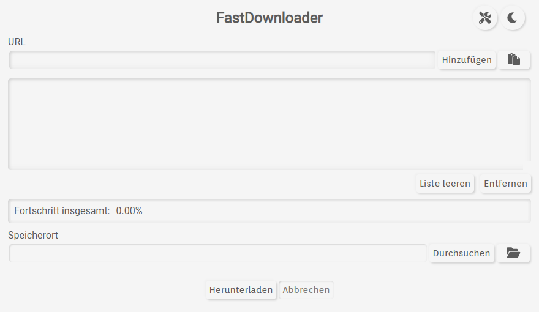
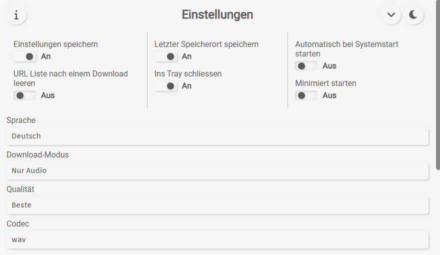
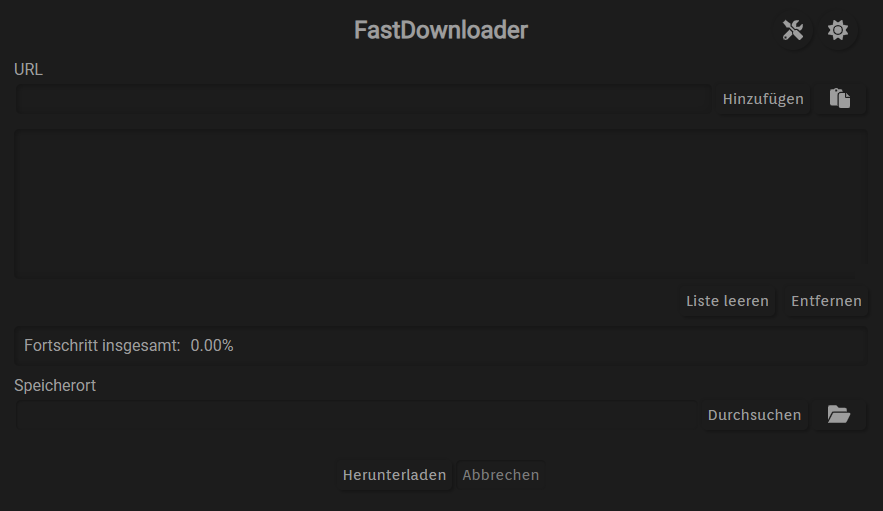

**FastDownloader** is a free, open-source desktop application for downloading video and audio from YouTube and many other websites. It combines a minimal Electron interface with [yt-dlp](https://github.com/yt-dlp/yt-dlp), [FFmpeg](https://ffmpeg.org/), and optional YouTube Music matching.

The number and availability of supported websites depend on the installed version of yt-dlp. See its [supported sites list](https://github.com/yt-dlp/yt-dlp/blob/master/supportedsites.md) for the current extractor list.

**Current application version: 0.9.0**

## Features

### Downloading and queue management

- Download **audio-only** files or **video with audio**.
- Add multiple URLs at once by typing, pasting, or entering several whitespace- or newline-separated links.
- Download individual links and **YouTube playlists** in the same queue.
- **Resolve playlists when they are added**, rather than waiting for the download to start.
- **Expand or collapse playlists** to inspect their individual tracks and follow their progress.
- Run **1–4 simultaneous downloads** (2 by default). Track metadata is prepared concurrently with downloads to reduce gaps between transfers.
- **Add more URLs while a download is running**; new items join the active queue.
- **Pause and resume the queue**. Pausing stops new jobs and metadata preparation but allows transfers already in progress to finish. Aborting stops the active download processes.
- Remove queued URLs while downloading. Not-yet-started jobs are removed; already-running transfers are allowed to finish unless the whole batch is aborted.
- Follow **per-track, per-playlist, and total download progress**, including the Windows taskbar progress indicator.
- Keep different downloads from writing to the same output path simultaneously.
- Retry certain transient failures, including network, permission/cookie, and HTTP 403 errors. Some failures still require user intervention.
- Optionally clear the URL list after a **successful** download batch.

### Per-item controls

Right-click a URL, playlist, or individual playlist track to override the global download settings for that item:

- Audio-only or video-with-audio mode
- Audio quality (for audio downloads)
- Audio or video codec preference
- Individual download directory
- Copy selected top-level URLs to the clipboard

Playlist-level settings are inherited by tracks unless a track has its own override. Settings for a queued track are read when that track actually starts, so changes made while it is waiting can still take effect. Settings for an already-running transfer do not change mid-download.

You can also select multiple top-level URLs with **Ctrl** or **Shift** and apply supported context-menu settings to the selection.

### YouTube and YouTube Music

- **Best-effort YouTube-to-YouTube Music matching** for eligible YouTube links in audio mode. Matching uses titles, artists, durations, and similarity checks. If no suitable match is found, the original URL is retained.
- **Optional YouTube Premium support** through browser cookies; no separate in-app account sign-in.
- Browser choices: **Google Chrome, Mozilla Firefox, Microsoft Edge, and Opera**.
- Premium cookie handling is applied to YouTube URLs when enabled. **Chrome cookie extraction is currently skipped on Windows** by the application, even if Chrome is selected; choose a supported alternative browser for that use case.
- YouTube playlists are resolved into individual URLs, and YouTube Music playlist entries retain their music domain where applicable.

YouTube Premium features require an appropriate subscription and a browser session signed in to that account. Cookie extraction also depends on browser, platform, and yt-dlp compatibility; it is not guaranteed to work in every environment.

### Desktop experience

- Clean interface with **light and dark themes**; the selected theme persists across restarts.
- System tray controls for showing/hiding the window, adding links from the clipboard, starting/pausing/resuming/aborting downloads, choosing a save location, clearing the list, and exiting.
- Optional **close to tray**, **start minimized**, and **start automatically with the operating system**.
- Optional saving of application settings and the last selected download directory.
- On-screen notifications and native desktop notifications when the window is not visible.
- Built-in **release changelog** viewer, with release information loaded from GitHub.
- Application update checks using `electron-updater` and an option to restart to install a downloaded update; update availability depends on the published release/package format.
- Automatic checks for **yt-dlp updates**, including refreshing the supported extractor list.
- Deno installation/update handling for JavaScript-runtime requirements used by some yt-dlp extractors.
- **16 interface languages**: Arabic, Bengali, Chinese, Dutch, English, French, German, Hindi, Indonesian, Italian, Japanese, Korean, Portuguese, Russian, Spanish, and Turkish.

## Getting started

1. Download a suitable release from [GitHub Releases](https://github.com/BERNARDO31P/FastDownloader/releases).
2. Open FastDownloader, then open **Settings**.
3. Select **Audio only** or **Video and audio**, choose the relevant codec (and audio quality if applicable), and select your download directory.
4. Paste one or more supported URLs into the main window and click **Add**, or use the paste button. You can also use the tray menu to add a link from the clipboard.
5. For a YouTube playlist, wait for its tracks to be resolved. Use the arrow beside the playlist to expand it.
6. Optionally right-click an item to customize its settings, then click **Download**.
7. Use **Pause / Resume** to control when further jobs start, or **Abort** to stop the batch.

**Tip:** You can continue adding links or adjusting settings for queued items while downloads are in progress.

### List and keyboard controls

| Action | Control |
| --- | --- |
| Add a URL from the input | **Enter** or **Add** |
| Paste one or more URLs | Paste button |
| Select several top-level URLs | **Ctrl + click** |
| Select a range | **Shift + click** |
| Select all top-level URLs | **Ctrl + A** when working in the list |
| Remove selected URLs | **Delete** or **Remove** |
| Copy selected top-level URLs | **Ctrl + C** or right-click **Copy** |
| Expand / collapse a playlist | Arrow beside the playlist |
| Override a URL or track | **Right-click** the relevant row |
| Open the download directory | Folder button beside the selected location |

## Settings reference

| Setting | Options / behavior |
| --- | --- |
| Save settings | Persist chosen application settings across restarts. |
| Save last storage location | Reuse the last selected output folder. |
| Close to tray | Hide the main window instead of closing the application. |
| Start minimized | Start with the main window hidden. |
| Start automatically at system startup | Enable or disable OS autostart. |
| Clear URL list after download | Remove the list after a successful batch; an aborted batch does not trigger this. |
| Language | Select one of the 16 translations. Changing the language restarts the application and temporarily restores the URL list and output location. |
| Download mode | **Audio only** or **Video and audio**. |
| Simultaneous downloads (threads) | **1, 2, 3, or 4**; default **2**. This controls concurrent download jobs, not the `-N 2` fragment setting passed to yt-dlp. |
| Audio quality | **Best**, **Medium**, or **Bad** (yt-dlp audio-quality values `0`, `5`, or `9`). |
| Audio codec | **AAC, FLAC, MP3, M4A, Opus, Vorbis, WAV**. |
| Video codec preference | **VP9, AV1, H.264/AVC, H.265/HEVC, H.266/VVC**. |
| YouTube Premium | Optionally request browser cookies for eligible YouTube downloads. |
| Browser | **Chrome, Firefox, Edge, Opera**; see the Windows Chrome limitation above. |

Audio downloads use FFmpeg-based extraction/conversion through yt-dlp. The application attempts to embed thumbnails for MP3, AAC, and FLAC audio. Video downloads prefer the selected codec and request **MP4** as the merged output container; the actual result depends on the formats offered by the source and FFmpeg support. Codec selection is a preference, not a guarantee that every site provides that format.

Downloaded file names are derived from media titles and metadata. In audio mode, an available artist (or a suitable channel fallback) is included as `Artist - Title`; invalid filename characters are replaced.

## Platforms and distribution

The project's build configuration targets:

| Platform | Configured package formats |
| --- | --- |
| Windows (x64) | NSIS `.exe` installer |
| Linux | `.deb`, `.AppImage`, `.rpm`, `.tar.gz`, `.pacman` |

The original project documentation lists testing on **Windows 10/11, Ubuntu/Debian, CentOS/Red Hat, and Arch Linux**. The availability of a given format is determined by the actual published releases. An [AUR listing](https://aur.archlinux.org/packages/fastdownloader-bin) is also referenced by the project.

macOS-specific binary lookup code exists, but **macOS is not configured as a release build target** in `package.json`.

## Build from source

FastDownloader uses Electron and Node.js. From the project directory:

```bash
npm ci
npm start
```

Build release artifacts with the configured scripts:

```bash
npm run build_win   # Windows
npm run build_unix  # Linux
npm run build       # Windows and Linux
```

Additional deployment scripts (`deploy`, `deploy_win`, and `deploy_unix`) invoke `electron-builder` with publishing enabled. Use these only when your release configuration and credentials are ready.

### Required external binaries and resources

The download engine relies on **yt-dlp** and **FFmpeg**. On Linux, installed system binaries are preferred; on Windows, configured bundled binaries are preferred when present. Deno is installed or updated automatically at application startup if its cached path is available or installation succeeds, which requires internet access and may invoke PowerShell or a shell installer.

The `electron-builder` configuration also expects these files for distribution:

- **Windows:** `resources/yt-dlp.exe`, `resources/ffmpeg.exe`, `resources/ffprobe.exe`, `resources/icons/256x256.png`, and `resources/icons/64x64.png`.
- **Linux:** `resources/yt-dlp_linux`, `resources/ffmpeg_linux`, `resources/icons/256x256.png`, and `resources/icons/64x64.png`.

**Note:** These `resources/` files are **not included in the supplied source ZIP**. Supply the expected files before attempting a complete packaged build. `npm ci` alone does not install those external binaries or icons. In a development environment, the application may locate system-installed yt-dlp/FFmpeg, but the tray icon also requires the expected image resources.

## How it works

FastDownloader uses yt-dlp to inspect supported URLs, retrieve media metadata, and download files. FFmpeg performs audio conversion and media merging. YouTube Music lookups use `youtube-sr`, `ytmusic-api`, and similarity matching in a web worker. The Electron main process provides the window, tray, OS integration, update handling, notifications, and directory dialog.

Playlist resolution runs as soon as a playlist is added, and the download scheduler separately manages preparation and transfer jobs. This allows multiple transfers and metadata lookups to overlap without counting a single playlist as only one download. A queued job's settings are captured when its transfer starts; downloads sharing the same output file path are serialized.

The application uses Electron local storage for preferences and the last selected folder (when enabled). It also temporarily caches the visible URL list and destination when switching languages. **There is no general persistent download-history or interrupted-download recovery feature** in this codebase.

## Troubleshooting and important limitations

- **A website is rejected:** Check whether your version of yt-dlp supports it. Some extractors may be marked as temporarily broken, and site compatibility can change over time.
- **Playlist entries do not appear:** Playlist expansion requires a successful yt-dlp lookup and an internet connection; a failed lookup is shown as an error.
- **Audio conversion or video merging fails:** Confirm FFmpeg is available and that the requested formats exist on the source site.
- **Premium access fails:** Confirm that the subscription and browser session are valid. Browser-cookie extraction may require closing the browser. Chrome cookies are not used by this application on Windows.
- **YouTube formats fail:** Some yt-dlp extractors require a working JavaScript runtime such as Deno. Review the Deno installation/update output and your yt-dlp version.
- **Pause does not immediately stop a transfer:** This is intentional; active transfers finish before the queue enters the paused state. Use **Abort** to stop them.
- **Settings are missing after restart:** Enable **Save settings**; per-item overrides and the download queue are not a general persistent session history.
- **An update is not offered:** Auto-update behavior depends on the OS, the installer/package format, and whether update metadata was published.

Only download content you have permission to access, and comply with applicable laws and the source website's terms.

## Screenshots

**Main window — light theme**



**Settings — light theme**



**Main window — dark theme**



## Main dependencies

Versions below are taken from the **0.9.0 `package.json`**, not from older README entries.

| Dependency | Version | Purpose |
| --- | --- | --- |
| [Electron](https://www.electronjs.org/) | 45.2.3 | Desktop runtime |
| [electron-builder](https://www.electron.build/) | 26.18.0 | Packaging and publishing |
| [electron-updater](https://www.npmjs.com/package/electron-updater) | 6.8.11 | Application updates |
| [auto-launch](https://www.npmjs.com/package/auto-launch) | 5.0.6 | OS autostart |
| [youtube-sr](https://www.npmjs.com/package/youtube-sr) | 4.3.12 | YouTube metadata lookup |
| [ytmusic-api](https://www.npmjs.com/package/ytmusic-api) | 5.3.1 | YouTube Music search |
| [fastest-levenshtein](https://www.npmjs.com/package/fastest-levenshtein) | 1.0.16 | Music-title similarity matching |
| [terminate](https://www.npmjs.com/package/terminate) | 2.8.0 | Process-tree termination |
| [@electron/asar](https://www.npmjs.com/package/@electron/asar) | 4.3.1 | Application archive tooling |

External programs: [yt-dlp](https://github.com/yt-dlp/yt-dlp), [FFmpeg](https://ffmpeg.org/), and [Deno](https://deno.com/). Their installed versions are **not pinned in `package.json`** and may change through updates or the supplied release binaries.

If you notice a translation error, please [open an issue](https://github.com/BERNARDO31P/FastDownloader/issues).

## License

FastDownloader is distributed under the **GNU General Public License v3.0**. See [LICENSE.md](LICENSE.md).